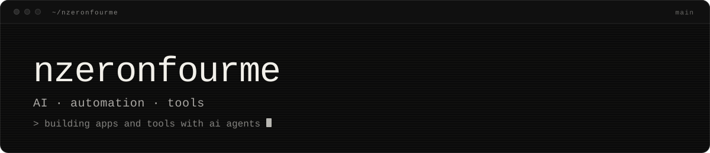

  
   
  
  

<pre>
role    beginner dev with AI agents
method  plan, build, verify
stack   python · typescript · powershell
site    nzeronfourme.vercel.app
</pre>

## selected_work

**[MovieShort-AI](https://github.com/nzeronfourme/MovieShort-AI)** · `python` · `v2.1.2` Automatic movie clipping for YouTube Shorts: scene detection, LLM scoring, face tracking, subtitles, vertical crop.

**[pcx](https://github.com/nzeronfourme/pcx)** · `powershell` · `v0.1.1` Windows 10/11 optimizer for AI coding agents. One command scans the PC, shows one measured table, applies only what you pick, and undoes typed changes.

**[tg-collab](https://github.com/nzeronfourme/tg-collab)** · `python` · `no release yet` Local-first tool for finding Telegram collab partners: channel discovery, ranking, CRM, and message drafts (CLI, Web UI, AI-agent skill).

## stack

`languages`   

`app`    

`tools`   

## stats

<a href="https://nzeronfourme.vercel.app/"><code>nzeronfourme.vercel.app</code></a>

